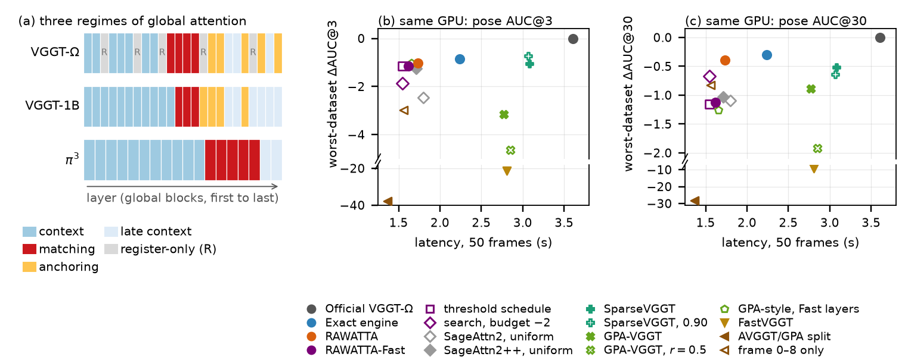

# RAWATTA

**Regime-AWare ATTention Approximation: training-free acceleration of the multi-view 3D transformer VGGT-Ω, on a native Rust + CUDA engine.**

[](https://github.com/sezer-muhammed/rawatta/actions/workflows/ci.yml)
[](#licences)

[](https://sezer-muhammed.github.io/rawatta/)

Code for the paper *Training-Free Acceleration of Multi-View 3D Transformers via Regime-Aware Attention
Approximation* by M. Izzet Sezer and Sevval Belkis Dikkaya (arXiv: coming soon). Project page (live at launch):
<https://sezer-muhammed.github.io/rawatta/>.

<p align="center">
  
</p>

<sub>Figure 1 of the paper. (a) Global attention in multi-view transformers follows three regimes (10 frames, 7 datasets).
(b, c) On one RTX 4070 SUPER: latency at 50 frames against the change in pose AUC@3 / AUC@30 on the worst of six
datasets, relative to Official VGGT-Ω (the released PyTorch code).</sub>

## TL;DR

Multi-view global attention is structured, not sparse. Every global layer of VGGT-Ω plays one of three roles, and
each role tolerates a different approximation (paper, Sec. 3):

| Regime | Blocks of VGGT-Ω | What the layer does | What it tolerates |
|---|---|---|---|
| Context | 0–8 except 2 and 6; late context 17, 18, 22 | averages over the whole scene (blocks 0–8: normalised entropy 0.81–0.98); 17, 18, 22 are diffuse again | 4×4 key merging; frame attention only in the early ones (0–8), not in 17, 18, 22 |
| Matching | 10–16 except 14 | matches points across many images | nothing: stays dense |
| Anchoring | 19, 21, 23; partly 15, 16 | sends 52–62% of its attention to the first image (10 frames) | merging, if frame 0 keeps all its keys |

Blocks 2, 6, 9, 14 and 20 are register-only: their global layer attends only among the special tokens of all frames,
and no setting changes them.

**RAWATTA** runs every dense global attention layer (the 19 non-register global layers) in 8-bit (INT8 QKᵀ, FP8 P·V
with FP16 block accumulation, following SageAttention2++) and keeps 16-bit P·V only in the two layers a worst-case
calibration check flags (blocks 4 and 15); VGGT-Ω's per-frame attention layers and the 5 register-only global layers
stay bf16. **RAWATTA-Fast** also gives blocks 0, 4 and 5 frame attention and merges keys 4×4 in blocks 3 and 19;
matching layers and frame 0 keep all their keys. Nothing is trained and the weights are unchanged.

<details>
<summary>Terms used here</summary>

- **AUC@3 / AUC@30**: area under the pose-accuracy curve up to a 3° / 30° rotation and translation-direction angle
  error (the official VGGT-Ω protocol), in points out of 100. **Worst-dataset**: the largest loss over the six
  evaluation datasets, so a loss on one dataset cannot hide behind gains on others.
- **N**: the number of frames (images) in one forward pass. Inputs are resized to 512 px on the long side
  (512×336 for the timing scene).
- **Frame blocks and global blocks**: each of VGGT-Ω's 24 blocks has a per-frame attention layer (tokens of one frame
  attend to each other) and a global layer (all tokens of all frames). RAWATTA changes only global layers. Its
  *frame attention* operator makes a global layer behave like a per-frame one.
- **QKᵀ, P·V**: the two matrix products of attention (scores, then the weighted sum of values). **E4M3**: the 8-bit
  floating-point format (FP8) used for P and V.
- **sm_89+**: compute capability 8.9 or newer, e.g. RTX 40xx/50xx, L4, L40, H100. A100 and RTX 30xx (sm_80/86) can
  run only the exact engine (built for them, not yet run on them).

</details>

## What you get

- **`rawatta`**, a single binary with a native Rust + CUDA engine for VGGT-Ω: DINOv3 patch embedding, the 24
  frame/global blocks, camera head and DPT dense head, preprocessing that matches the official loader for same-size
  inputs (PIL-exact bicubic resize, libjpeg decoding; frames of another aspect ratio are centre-cropped to the first
  frame's instead of padded), and a static memory planner. Kernels are compiled at run time with NVRTC, so no `nvcc` is
  needed; with the Docker image the host needs only the NVIDIA driver.
- **Three named settings**: `rawatta` (default), `rawatta-fast`, and `exact` (the exact engine: no attention
  approximation, i.e. exact bf16 attention with bf16 weights; vs Official VGGT-Ω: −0.86 worst-dataset AUC@3, Tab. 4),
  plus a [config grammar](configs/GRAMMAR.md) for any per-layer schedule and precision.
- **Outputs**: cameras (`cameras.json`, `extrinsics.npy`, `intrinsics.npy`), depth and confidence maps, a coloured
  point cloud (`points.ply`), a COLMAP text model, and `timing.json`.
- **Tooling**: a torch-free weight converter ([tools/](tools/README.md)), evaluation under the official VGGT-Ω
  protocol on the paper's six datasets ([eval/](eval/README.md)), the calibration check and searches
  ([calibration/](calibration/README.md)), a Docker image ([docker/](docker/README.md)) and
  [examples](examples/README.md).

## Results

From the paper (Tab. 1). These numbers come from the authors' research codebase, from which this release was
extracted; the kernel sources are unchanged apart from renames ([crates/ARCHITECTURE.md](crates/ARCHITECTURE.md)).
End-to-end parity with the paper's runs is pending until the weights are available, and nothing below has been
re-measured with this release yet (see [REPRODUCE.md](REPRODUCE.md)).

| Setting | N = 50: ms | × Official | N = 200: s | × exact | worst ΔAUC@3 vs exact | worst ΔAUC@30 vs exact | worst ΔAUC@3 vs Official |
|---|---:|---:|---:|---:|---:|---:|---:|
| Official VGGT-Ω | 3605 | 1.00 | OOM | – | – | – | 0 |
| Exact engine | 2237 | 1.61 | 20.74 | 1.00 | 0 | 0 | −0.86 |
| **RAWATTA** | 1734 | 2.08 | 12.51 | 1.66 | −0.51 ± 0.11 | −0.24 | −1.03 |
| **RAWATTA-Fast** | 1616 | 2.23 | 10.56 | 1.97 | −0.80 ± 0.17 | −1.20 | −1.14 |

Latency: full forward pass (trunk, camera and dense heads), one RTX 4070 SUPER (12 GB, CUDA 12.8), Mip-NeRF 360
kitchen at 512×336; the exact engine and RAWATTA use the mean of three timing sessions, RAWATTA-Fast the 1616.4 ms
session in which the rivals were timed (three-session mean 1611.8 ms; Supp. Tab. 23); Official VGGT-Ω runs out of memory at N ≥ 100. Accuracy: change in pose
AUC@3 / AUC@30 on the worst of six evaluation datasets (ETH3D, CO3Dv2, RealEstate10K, 7-Scenes, NRGBD, TUM-dynamic)
at N = 10, mean ± std of the per-seed worst over three frame-sampling seeds; differences below about 0.5 AUC@3 are
seed noise.

**Where the speed comes from.** Of the 2.08× at 50 frames on the RTX 4070 SUPER, 1.61× is the CUDA engine and 1.29×
RAWATTA itself; at 200 frames RAWATTA alone gives 1.66× (RAWATTA-Fast 1.97×) over the exact engine (Tab. 2). Against
Official VGGT-Ω, 0.86 of RAWATTA's −1.03 worst-dataset AUC@3 already comes from the exact engine (Tab. 4). Depth
accuracy (δ1.25, AbsRel) stays within 0.02 points and 0.0002 of Official for both settings. RAWATTA and RAWATTA-Fast
run 200 frames in 12.5 s and 10.6 s at a 9.7 GiB peak on the 12 GB card (Sec. 5.5).

**Why "exact" is not identical to Official.** "Exact" means no attention approximation, not bit-identical to the
PyTorch code: the engine runs bf16 weights and bf16 attention, while Official VGGT-Ω keeps fp32 weights under bf16
autocast. The paper does not isolate the cause of the −0.86 worst-dataset gap; the two differ only on ETH3D
(0.8 AUC@3; Sec. 4.5, Tab. 4).

The project page and [REPRODUCE.md](REPRODUCE.md) have the other tables (published accelerators on the same GPU,
scaling, a second GPU class).

## Requirements

| | |
|---|---|
| OS | Linux x86_64 |
| Driver | NVIDIA driver that supports CUDA 12.8 or newer (`nvidia-smi` shows "CUDA Version: 12.8" or higher) |
| GPU for `rawatta`, `rawatta-fast` | compute capability 8.9 or newer (sm_89+: Ada, Hopper, Blackwell), for the FP8 tensor-core instructions. Run on Ada (RTX 4070 SUPER) and, in the paper, Blackwell sm_120 (RTX PRO 6000); Hopper (sm_90) and sm_100 are built and ptxas-checked but not yet run |
| GPU for `exact` | compute capability 8.0 or newer (sm_80+). Built and bit-checked for sm_80+, not yet run on Ampere hardware |
| Memory | the paper's 12 GB card fits 200 frames (Sec. 5.5); on a smaller card use fewer frames (`rawatta run` checks the memory plan before it decodes the frames and says so) |
| Docker route | Docker with the [NVIDIA Container Toolkit](https://docs.nvidia.com/datacenter/cloud-native/container-toolkit/latest/install-guide.html) (`docker run --gpus all` must work). Building the image needs BuildKit (the default since Docker 23; on older Docker run `DOCKER_BUILDKIT=1 docker build ...`) |
| Native route | Rust 1.99+ and a C compiler to build; at run time the CUDA 12.x NVRTC and cuBLASLt libraries (12.8 or a newer 12.x: `libnvrtc.so.12`, `libcublasLt.so.12`; CUDA 13 libraries are not picked up). If `rawatta info` says they are not found, add the toolkit's `lib64` (e.g. `/usr/local/cuda-12.8/lib64`) to `LD_LIBRARY_PATH` |

`rawatta info` prints the GPU, its compute capability and memory, the driver's CUDA version, whether RAWATTA and the
exact engine can run, whether NVRTC and cuBLASLt load, and where it looks for the weights.

## Quickstart

**1. Request access to the weights.** The VGGT-Ω weights are gated on Hugging Face under the FAIR Noncommercial
Research License. Sign in and request access on the [model page](https://huggingface.co/facebook/VGGT-Omega). Meta
reviews requests by hand, which can take a while; downloads return 401/403 until you are approved. Then create a Read
token (a fine-grained token needs "Read access to contents of all public gated repos you can access") and save it with
`hf auth login` (from `pip install -U huggingface_hub`; older versions: `huggingface-cli login`). It lands in
`~/.cache/huggingface/token`. Without Python, save it there by hand, without putting it on a command line:

```sh
mkdir -p ~/.cache/huggingface ~/.cache/rawatta    # create both yourself, so that they belong to you and not to root
(umask 077; cat > ~/.cache/huggingface/token)      # paste the token, press Enter, then Ctrl-D
```

**2. Download the weights and reconstruct (Docker).** The host needs only Docker and the NVIDIA driver. The image
`ghcr.io/sezer-muhammed/rawatta` is published at v0.1.0; pulling it before then fails with `error from registry:
denied`. Until then, build it in a clone (`git clone https://github.com/sezer-muhammed/rawatta && cd rawatta`) with
`docker build -f docker/Dockerfile -t rawatta .` and use `rawatta` in place of
`ghcr.io/sezer-muhammed/rawatta:latest`, or build with `-t ghcr.io/sezer-muhammed/rawatta:latest` to run the commands
below unchanged.

```sh
mkdir -p ~/.cache/huggingface ~/.cache/rawatta    # if not done in step 1: Docker would create them owned by root
# weights, once (host needs only Docker + NVIDIA driver; token file from 'hf auth login' or saved by hand)
docker run --rm --user "$(id -u):$(id -g)" -v ~/.cache/huggingface:/hf:ro -v ~/.cache/rawatta:/weights \
  --entrypoint download-weights ghcr.io/sezer-muhammed/rawatta:latest --token-file /hf/token --dir /weights
# reconstruct
docker run --rm --gpus all --user "$(id -u):$(id -g)" -v ~/.cache/rawatta:/weights:ro -v "$PWD":/work \
  ghcr.io/sezer-muhammed/rawatta:latest run --images photos --config rawatta --out out
```

`photos` is a folder of images (`.jpg`, `.jpeg`, `.png`, `.webp`) in the current directory; the results land in
`./out`. The first image is the reference: world coordinates are its camera's. The download writes
`vggt_omega_1b_512.safetensors` into `~/.cache/rawatta` and deletes the original checkpoint after converting it
(append `--keep-pt` to keep it). No photos at hand? `examples/buddha/fetch.sh` (in a clone) downloads 34 CC BY 4.0
photos into `data/examples/buddha/images`. More on the image (volumes, file ownership, choosing a GPU):
[docker/README.md](docker/README.md).

**Native alternative.**

```sh
git clone https://github.com/sezer-muhammed/rawatta && cd rawatta
cargo build --release -p rawatta-cli
tools/download_weights.sh        # needs curl, python3 >= 3.10, numpy; writes ~/.cache/rawatta/vggt_omega_1b_512.safetensors
target/release/rawatta info
target/release/rawatta run --images photos --config rawatta --out out
```

`tools/download_weights.sh` takes the token from `$HF_TOKEN`, `--token-file`, `$HF_HOME/token` or
`~/.cache/huggingface/token`, checks the checkpoint's SHA-256 and converts it ([tools/README.md](tools/README.md)).
`rawatta` finds the weights at `~/.cache/rawatta/vggt_omega_1b_512.safetensors` by default; `--weights` or
`RAWATTA_WEIGHTS` point it elsewhere.

## Usage

With Docker, `docker run --rm --gpus all --user "$(id -u):$(id -g)" -v ~/.cache/rawatta:/weights:ro -v "$PWD":/work
ghcr.io/sezer-muhammed/rawatta:latest` stands in for `rawatta` below (paths relative to the current directory).

```sh
rawatta info                                                   # GPU, compute capability, what it can run
rawatta run --images photos --out out                          # default config: rawatta
rawatta run --images photos --config rawatta-fast --out out
rawatta run --images photos --config exact --out out           # the exact engine (sm_80+)
rawatta run --video clip.mp4 --max-frames 64 --out out         # frames sampled uniformly (needs ffmpeg)
rawatta run --images photos --out out --reps 5 --warmup 2      # median of 5 timed passes in timing.json
rawatta bench --job job.json                                   # many configs x many sequences, see below
```

Other `run` options: `--max-frames N` (uniform sampling, first and last kept), `--crop-aspect H/W` (centre crop
first), `--no-depth` (skip `depth.npy` and `conf.npy`), `--max-points`, `--conf-percentile`, `--weights`. See
`rawatta run --help`.

**Outputs** of `rawatta run --out <dir>`:

| File | Content |
|---|---|
| `cameras.json` | per frame: world-to-camera 3×4 matrix (OpenCV axes), 3×3 intrinsics, image name; world = frame 0 |
| `extrinsics.npy`, `intrinsics.npy` | the same cameras as arrays (N,3,4) and (N,3,3) |
| `depth.npy`, `conf.npy` | depth and confidence maps (N,H,W); not written with `--no-depth` |
| `points.ply` | coloured point cloud from the depth maps, confidence-filtered |
| `colmap/` | COLMAP text model (`cameras.txt`, `images.txt`, `points3D.txt`) and the frames as the network saw them |
| `timing.json` | forward latency (median and IQR over `--reps` timed passes), peak GPU memory, config, GPU name |

[examples/](examples/README.md) has scripts for photos and videos, a comparison of the three settings, numpy loaders
for the outputs and a guide to training Gaussian splats from `colmap/`.

**Configs.** `--config` takes a named setting or a config string `<schedule>[@<precision>][~<overrides>][+fp8[:<blocks>]]`:

| Name | Config string | GPU |
|---|---|---|
| `rawatta` (default) | `dense@sagepp~L4=sage.pvh16/L15=sage.pvh16` | sm_89+ |
| `rawatta-fast` | `L0:frame/L3:merge4/L4:frame/L5:frame/L19:merge4@sagepp~L15=sage.pvh16` | sm_89+ |
| `exact` | `dense@bf16` | sm_80+ |

The precision applies to the dense global layers. Frame layers always run on the bf16 kernel; merged layers always
run on the quantised kernel (in plain `sage` when the precision is `bf16`). [configs/GRAMMAR.md](configs/GRAMMAR.md)
documents the grammar, the per-layer overrides and the other named configs of the paper (threshold schedule, uniform
SageAttention2, the AVGGT/GPA-style controls, ...); `configs/*.toml` describe the three settings and where the paper
defines them.

**Custom schedules.** Pass any config string, for example `--config "L0:frame/L19:merge4@sagepp~L15=sage.pvh16"`. A
config TOML (`configs/*.toml`, or one written by `calibration/calibrate.py --emit`) can be passed by its path; it
keeps its config string in the `grammar` field (format: [configs/GRAMMAR.md, "Config files"](configs/GRAMMAR.md#config-files)):

```sh
rawatta run --images photos --out out --config configs/my-setting.toml
```

**Calibrating your own setting.** [calibration/](calibration/README.md) reproduces the paper's procedure (Sec. 4.4,
on the paper's calibration subsets in `eval/manifests/paper/calibration.json`): candidate configs run on five calibration datasets and are accepted only if the worst dataset stays within an
accuracy budget against the exact engine. It writes the result as a config TOML.

**Benchmark jobs.** `rawatta bench --job job.json` runs every config on every sequence of a job
`{"out", "configs": [...], "reps", "warmup", "depth", "crop_aspect", "sequences": [{"name", "images": [...]}]}` and
writes `<out>/<config>/<sequence>/{extrinsics,intrinsics,depth,conf}.npy` and `cell.json`. `eval/run_eval.py` and
`calibration/calibrate.py` drive it.

## Repository layout

| Path | What | Licence |
|---|---|---|
| [`crates/rawatta-nn/`](crates/rawatta-nn) | CUDA building blocks: cuBLASLt GEMMs, fused LayerNorm, FlashAttention-2-style bf16 attention, SageAttention2-style INT8/FP8 attention with KV merging | Apache-2.0 |
| [`crates/vggt-omega/`](crates/vggt-omega/README.md) | the native VGGT-Ω engine: weights, preprocessing, memory planner, trunk, heads, config grammar, outputs, bench | FAIR Noncommercial Research License |
| [`crates/rawatta-cli/`](crates/rawatta-cli) | the `rawatta` binary | Apache-2.0 |
| [`configs/`](configs/GRAMMAR.md) | the three settings and the config grammar | Apache-2.0 |
| [`tools/`](tools/README.md) | weight download and converter | Apache-2.0 |
| [`eval/`](eval/README.md) | official-protocol evaluation, dataset scripts, frame manifests, Official VGGT-Ω runner | Apache-2.0 |
| [`calibration/`](calibration/README.md) | worst-case calibration check, precision and schedule searches | Apache-2.0 |
| [`research/`](research/README.md) | PyTorch harnesses the paper used for VGGT-1B and π³ (unsupported, kept as used) | Apache-2.0 |
| [`examples/`](examples/README.md) | run scripts, example scenes, Python helpers, gallery builder | Apache-2.0 (photos: their own licences) |
| [`docker/`](docker/README.md), `.github/`, `scripts/` | image, CI and release workflows, launch checklist | Apache-2.0 |
| [`docs/`](docs/index.html), [`site-src/`](site-src/README.md) | project page and its figure sources | page text and figures CC BY 4.0, scripts Apache-2.0 |

[crates/ARCHITECTURE.md](crates/ARCHITECTURE.md) maps every module and kernel. [REPRODUCE.md](REPRODUCE.md) gives the
commands behind each table of the paper.

## Licences

This repository has two main licences, and the VGGT-Ω weights a third party's:

- **Apache-2.0** ([LICENSE](LICENSE)): `crates/rawatta-nn` (CUDA building blocks and attention kernels),
  `crates/rawatta-cli`, `configs/`, `tools/`, `eval/`, `calibration/`, `research/`, `examples/`, `docker/`,
  `scripts/`, and the site scripts.
- **FAIR Noncommercial Research License** ([LICENSE-VGGT-OMEGA](LICENSE-VGGT-OMEGA)): `crates/vggt-omega`, a port of
  Meta's VGGT-Ω architecture. The `rawatta` binary and the Docker image contain this crate, so using them is bound by
  the FAIR licence too, including its noncommercial terms. Its DINOv3 backbone code (patch embedder, blocks, RoPE in
  `crates/vggt-omega/src/trunk/`) is also under the **DINOv3 License** ([LICENSE-DINOV3](LICENSE-DINOV3)), as in
  upstream VGGT-Ω.
- **The VGGT-Ω weights** are Meta's, gated on Hugging Face under the FAIR Noncommercial Research License. They are
  never bundled with or redistributed by this repository or its image: you download them yourself after accepting the
  licence. Under that licence the **outputs and results** of the weights (the cameras, depth maps and point clouds
  `rawatta` produces) may not be used commercially: **research use only**.

The project page text and figures are CC BY 4.0, except `docs/static/examples/`: the point clouds and cameras there are
outputs of the VGGT-Ω weights (FAIR Noncommercial Research License, noncommercial research use only); photos and
thumbnails keep their own licences (`examples/*/SOURCE.md`). Datasets keep their own licences
([eval/DATASETS.md](eval/DATASETS.md)); several are noncommercial. Third-party notices: [NOTICE](NOTICE); licence
texts of the Rust crates linked into the binary: [THIRD-PARTY-LICENSES.md](THIRD-PARTY-LICENSES.md).

## Limitations

From the paper (Sec. 6):

- **Calibrated, not universal.** Each model needs its own search. On VGGT-Ω, RAWATTA-Fast loses 2.2 AUC@3 on ETH3D at
  50 frames against Official, and no schedule is best at every sequence length. The regimes carry over to VGGT-1B and
  π³, but the thresholds of the threshold schedule do not.
- **Coverage.** Only ETH3D and NRGBD are unseen in calibration; the other four evaluation datasets share their source
  datasets, but not sequences, with calibration. Routing restricted to context or anchoring layers is untested.
- **Rivals and hardware.** Published accelerators were compared as PyTorch ports; on a 96 GB Blackwell GPU, GPA-VGGT
  outperforms RAWATTA at 500 frames.

Of this release:

- **Linux x86_64 only**, NVIDIA GPUs only. RAWATTA and RAWATTA-Fast need sm_89+; the exact engine is built and
  bit-checked for sm_80+ but has not yet been run on Ampere hardware.
- **Not every number can be re-derived from this repository.** The paper's evaluation and calibration subsets and
  per-seed frame maps are released (`eval/manifests/paper/`), but the ports of
  the rival methods onto VGGT-Ω are not included; `research/` is unsupported and was not re-run for this release.
  Details: [REPRODUCE.md](REPRODUCE.md).
- **Not yet re-measured.** The numbers above are the paper's. End-to-end runs of this release with the weights are
  still to be done.

## Citation

```bibtex
@article{sezer2026rawatta,
  title   = {Training-Free Acceleration of Multi-View 3D Transformers via Regime-Aware Attention Approximation},
  author  = {Sezer, M. Izzet and Dikkaya, Sevval Belkis},
  journal = {arXiv preprint arXiv:XXXX.XXXXX},
  year    = {2026}
}
```

[CITATION.cff](CITATION.cff) has the same entry.

## Acknowledgements

RAWATTA builds on **VGGT-Ω** by Meta (FAIR; Wang et al., CVPR 2026): the engine is a native port of the VGGT-Ω model
and runs its released weights. We acknowledge the use of these Research Materials, which Meta makes available under
the FAIR Noncommercial Research License, and of DINOv3 materials (the backbone's patch embedder, blocks and RoPE),
which Meta makes available under the DINOv3 License. The quantised attention kernels follow **SageAttention**, **SageAttention2**
and **SageAttention2++** (Zhang et al.) and are an independent implementation; the merged-key bias follows the
proportional attention of ToMe and GPA-VGGT. We thank the authors of SparseVGGT, GPA-VGGT and FastVGGT for releasing
the code we compared against, and the creators of ETH3D, CO3Dv2, RealEstate10K, 7-Scenes, Neural RGB-D, TUM RGB-D,
Mip-NeRF 360 and the example photo sets (Buddha Dataset by AliceVision, Korno climbing rock by Zbytovsky) for making
their data available.

Most of the engine and kernel code, and the scripts in this repository, were written with Anthropic's Claude models
acting as coding agents under the authors' supervision, as the paper's LLM usage statement describes. The authors
chose the method and protocols and checked the code, results and claims.
